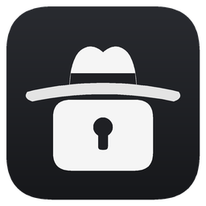
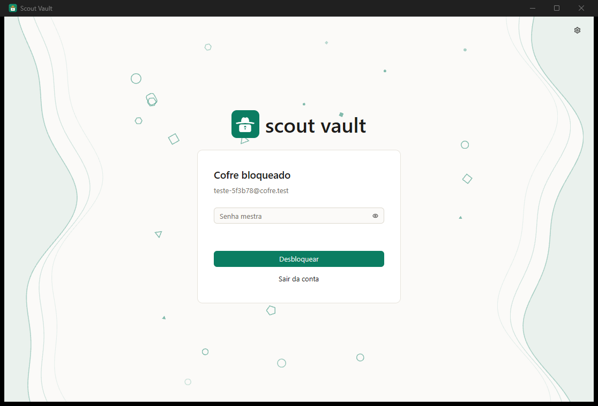
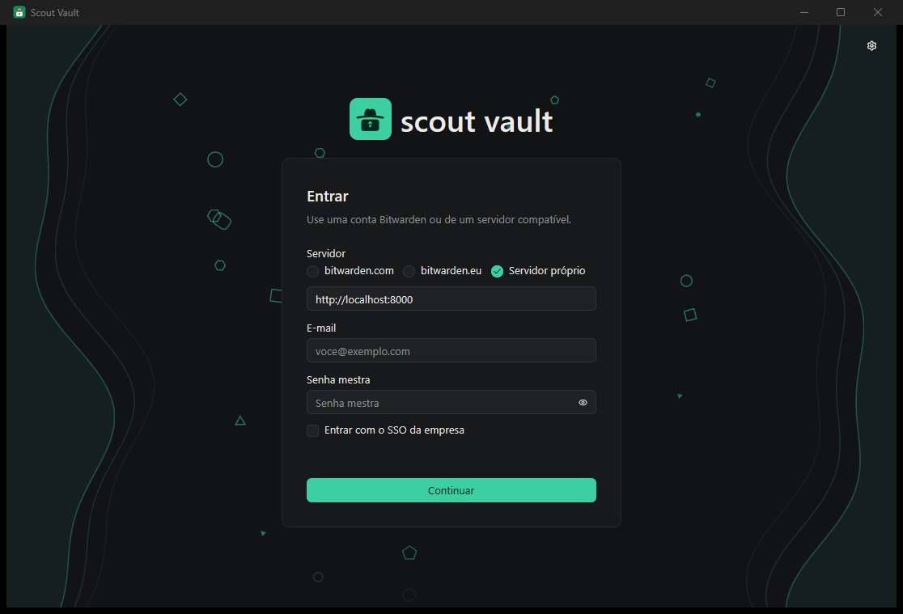

<p align="center"></p>

# Scout Vault

A native desktop client, written in **Rust + GPUI**, for Bitwarden-compatible servers (official
Bitwarden and Vaultwarden). The idea is a light, fast app for everyday use: open, search, copy and
close, without the weight of an Electron app.

> Unofficial project, not affiliated with Bitwarden Inc. **Under development — don't use it with your real vault yet.**


---

## Contents
- [What already works](#what-already-works)
- [Appearance and settings](#appearance-and-settings)
- [Shortcuts](#shortcuts)
- [Security](#security)
- [Architecture](#architecture)
- [Installing](#installing)
- [Prerequisites (Windows)](#prerequisites-windows)
- [Running](#running)
- [Development server](#development-server)
- [Tests](#tests)
- [Languages](#languages)
- [Adding a setting](#adding-a-setting)
- [What's new and releases](#whats-new)
- [Roadmap](#roadmap)

---

## What already works

**Signing in**
- bitwarden.com, bitwarden.eu or a self-hosted server (Vaultwarden).
- Vault (master) password with PBKDF2-SHA256 or Argon2id KDF. The password never leaves the
  machine: only a hash derived from it is sent.
- Two-step verification: authenticator, email code, YubiKey, FIDO2/Windows Hello security key
  (native Windows API) and Duo. "Remember this device" keeps the token in Windows Credential
  Manager.
- **Company SSO** login (browser + vault password, like the official CLI).
- Accounts with Bitwarden's **v2 cryptography** (COSE: XChaCha20-Poly1305, XAES-256-GCM).
- New device verification code.
- The server, the last email and the device identity are saved for next time.

**Using the vault**
- Virtualized list with search by name, username and address, keyboard navigable.
- Sidebar filters, each with a count: all items, favorites, by type (logins, cards, identities,
  notes, SSH keys), by organization, by folder, no folder and trash.
- The item detail shows every field, including custom fields and notes. Secrets start masked and
  can be revealed one by one.
- **Live authenticator code (TOTP)**, with the remaining seconds. Accepts a base32 key, an
  `otpauth://` URI (SHA-1/256/512, custom digits and period) and `steam://` (Steam Guard).
- When you copy a secret, the clipboard clears itself after 30 s (adjustable in settings: 10 s
  to 2 min, or never). It is only cleared if you haven't copied something else since. On
  Windows, what Scout Vault copies **stays out of the history (Win+V) and the cloud clipboard**.
- **Item icon**: click the large icon in an item's detail to choose another one (games, bank,
  email, work… 52 in total) and a color. The choice shows up in the list, quick access, quick
  search and the tray menu. It stays on this computer only: the item doesn't change on the server.
- **Password health** (`Ctrl+Shift+H` or the shield in the footer): a vault score and lists of
  weak, reused and passwords not changed in over a year; click an item to open it. "Check for
  leaks" compares against Have I Been Pwned using k-anonymity: only the first 5 characters of
  each password's SHA-1 leave the computer, and only when you ask.
- **Password generator** (`Ctrl+G` or the dice icon): length, character sets and an option to
  avoid look-alike characters. The options are saved; the generated password is not.
- **Quick search** (`Ctrl+Shift+Space`, from any window): a small window on top of everything to
  find an item by name, username or website and **fill** it into the focused app, **copy** the
  username, password or code, or **open** it in Scout Vault — without switching windows. Items
  that ask for the vault password still ask. Turned on/off in Settings › Session.
- **Fill in other apps** (`Ctrl+Alt+A`, from any window): Scout Vault picks the login by the
  window title (item name or website) and **types** `username ⇥ password ↵` into it, without
  going through the clipboard. If the title doesn't decide, it shows the list to choose from;
  with the vault locked, it asks for the password and types afterwards. Turned on/off (along with
  the final Enter) in settings.
- Syncing downloads the vault again without closing the open item. If the session expired on the
  server, the app goes back to the login screen with a notice.

**Editing** (encrypted on your machine before it leaves)
- **Import** (Settings → Data → Import…): Bitwarden JSON/CSV and passwords CSVs from Chrome, Edge,
  Brave, Opera, Firefox and Safari (or any CSV with `name`, `url`, `username`, `password`, `notes`).
  It shows what's in the file first (types, folders, entries left out) and skips items already in
  the vault; everything is encrypted here and sent in one request. Delete the export afterwards.
- **New item** (`+` in the list or `Ctrl+N`): login, note, card, identity or SSH key (a new
  Ed25519 key is generated, or import yours: OpenSSH, PuTTY `.ppk`, RSA PEM; the public key and
  fingerprint are filled in). **Edit**
  (`Ctrl+E`) any item, SSH keys included: name, fields, websites, custom fields, notes, folder
  and favorite. A button generates the password right there.
- When you change the password, the old one goes to the item's **password history** (as in the
  official apps).
- Scout Vault only changes what you edited: passkeys, URI rules, linked fields and other data
  created by other clients go back to the server untouched.
- **Trash**: move, restore and **delete permanently** (asks for confirmation).
- **Sidebar your way**: click a section's heading (Quick access, Types, Organizations, Folders)
  to collapse it, and right-click any entry to choose its icon and color. Both are remembered.
- **Quick access**: the pin in an item's detail pins it to a section at the top of the sidebar
  (up to 10). Clicking opens the item directly, even with another filter active. Saved on the
  computer.
- **Organizations**: when creating an item, choose the owner ("My vault" or the organization)
  and the collections it belongs to (only the ones you can edit). Existing organization items
  can change collections. Collections show up under each organization in the sidebar; creating
  an item with a collection open puts it there.
- **Folders**: `+` next to "Folders" in the sidebar creates one; with the folder open, the list
  header has rename and delete (its items go to "No folder"). The name is encrypted. **Drag** an
  item from the list onto a folder (or "No folder") to move it, and a folder onto another to make
  it a subfolder (in Bitwarden that is the name "Parent/Child"; dropping it on the "Folders"
  heading moves it back to the top). Subfolders are indented.
- **Attachments**: in a new item's form (or when editing) and in the item detail there is an area
  to **click or drag files** from Explorer (up to 500 MB each; several at once). You can open
  them with the default program, save them anywhere and remove them. Each attachment has its own
  key; the opened copy lives in `%TEMP%\ScoutVault-anexos` and is deleted on lock. On a free
  bitwarden.com account attachments require **Premium** — the app says so.
- Organization items you can only read don't show Edit.

**SSH agent** (Settings → SSH, off by default)
- Serves the open vault's SSH keys to Windows' `ssh` and `git` on the OpenSSH pipe
  (`\\.\pipe\openssh-ssh-agent`), like 1Password: each signature shows **who is asking**
  (e.g. `ssh.exe (git.exe)`) and **which key**, and waits for **Allow** (optionally confirmed with
  Windows Hello). The prompt also shows the program's full path. "Don't ask again for 10
  minutes" skips the question for that exact program (by path) and key, until the vault locks.
  Keys whose item asks for the master password need it for **every** signature and are never
  remembered. Locked vault = no keys. Nothing can add, remove or export keys through it.
- Windows' own "OpenSSH Authentication Agent" service uses the same pipe: stop and disable it
  (`services.msc`) to use Scout Vault's. For git, point it at Windows' ssh:
  `git config --global core.sshCommand C:/Windows/System32/OpenSSH/ssh.exe`.

**Browser autofill** (Chrome, Edge, Brave)
- Its own extension in the [`extension/`](extension/) folder. Turn it on in Settings → Browser and
  follow the instructions shown there (load the unpacked extension).
- On a site, click the Scout Vault icon or use `Ctrl+Shift+L`: the site's logins show up (base
  domain, as in Bitwarden). Click one to fill username and password.
- **Menu in login fields:** when you click a username or password field, the Scout Vault icon
  shows up on its edge (with how many logins the site has, or a padlock if the vault is locked).
  Click the icon, use `Alt+↓` in the field or `Alt+Shift+L` to open the list; arrows and `Enter`
  choose. "Don't show on this site" hides the icon there (undo it from the popup), and the popup
  has a switch to turn the menu off on every site. The page only sees names and usernames after
  you focus the field; the password comes from the app on click. Clicks simulated by the page, or
  with the menu hidden or covered, are ignored.
- The password only leaves the app when you click, and only for an item whose address belongs to
  the same site. The extension talks to the app through *native messaging* and a local channel
  that only your Windows user can access. With the vault locked, the app shows up asking for the
  password.
- **Saving logins:** when you sign in to a site with a login the vault doesn't have yet (or with
  a new password), "Save this login in Scout Vault?" (or "Update the password for …?") shows up in
  the corner of the page. Nothing is saved without the click; the old password goes to the item's
  history. With the vault locked, the app asks for the password and saves right after. For this
  the extension runs on every site (the browser warns when installing); it only reads the form
  when it is submitted.

**Windows tray**
- Closing the window (X or Alt+F4) keeps the app running in the icon near the clock: `Ctrl+Alt+A`
  and browser autofill keep working. Click the icon to open. Right-click opens the app's own menu
  (with the theme and accent color, icons and animation), with **Open**, **Quick access** (copy
  the username, password or code of pinned items without opening the window), **Generate and
  copy password**, **Sync now**, **Lock**/**Unlock…** and **Quit**. Opening the executable again
  just shows the existing window. It can be turned off in Settings → Session.

**Session and locking**
- **Remember session** (on by default): when you open the app, it goes straight to unlock, with
  only the vault password, and **opens even without internet**. It keeps the vault **encrypted**
  as it came from the server in `%APPDATA%\Scout Vault\sessao.json` and the refresh token in
  Windows Credential Manager. "Sign out" or turning the option off deletes both.
- **How long to stay signed in** (Settings → Session):
  - *Ask for the vault password on open*: always, or remember for 1, 7 or 30 days. During that
    period the app opens already unlocked; the key is kept in Credential Manager, expires at the
    end of the period and is discarded if the vault password changes (the app notices on sync).
  - *Ask for a full login every*: 7, 30 (default) or 90 days, or never.
  - *Lock when idle after*: 1, 5 (default), 15 or 60 minutes, or never.
  - *Sync in the background* (on by default): every minute the app asks the server whether the
    vault changed (only the date of the last change, without downloading anything) and, if it
    changed on another device, syncs on its own and lets you know. With a form open, it waits.
  - *Unlock with Windows Hello* (off by default): face, fingerprint or PIN instead of the vault
    password. Windows Hello signs a challenge with a key that never leaves the TPM; that
    signature encrypts the user key, and only the encrypted version is kept in Credential
    Manager. Changing the vault password or signing out deletes the setup.
  - *Lock together with Windows* (on by default): when you lock the computer (Win+L) or it
    sleeps/hibernates, the vault locks too.
  - *Lock on minimize* (off by default): minimizing the window or closing it to the tray locks
    right away.
- Locks with the padlock button, `Ctrl+L`, the tray, or on its own when idle.
- On lock, the decrypted vault leaves memory. Unlocking only needs the vault password, no network.
- **Ask for the vault password to view** (an item option, as in Bitwarden): showing, copying or
  editing the secret data and typing with `Ctrl+Alt+A` ask for the password again; the approval
  lasts until you switch items. The check is local (no network). The browser doesn't fill these
  items.

## Appearance and settings

Scout Vault has its own minimalist look. Backgrounds are warm neutrals (a paper tone in light
mode, deep graphite in dark mode), and there is **a single accent color**, used only where it
matters: selection, focus, primary button, favorites and the brand. Icons come from
[Lucide](https://lucide.dev) and sit inside soft little squares.

| Light | Dark |
|---|---|
|  |  |

The **login and unlock** screens have animated vector art in the background: wavy bands on the
sides that sway slowly and small closed shapes (dots, circles, triangles, squares, diamonds,
pentagons and hexagons) rising and spinning slowly through the middle, all in a thin stroke in
the accent color. The large brand mark sits centered above the form. It is drawn by the app
itself every frame, with no images, and only moves while the window has focus.

The interface also has **short animations** (up to ~¼ s, opacity and position only): screens and
panels ease in, the sidebar cascades in, the chosen filter lights up, the list selection wraps
the item's icon, error messages give a slight shake, "Signing in…" pulses, a thin bar runs while
syncing or saving, the sync icon spins and turns into ✓, and the copy button turns into ✓.
Notices ("Copied", "Item created", errors) appear as **toasts** that rise from the bottom of the
window, stay a few seconds and slide away. When you change the theme, accent color, text size or
corners, the interface transforms in place: each color goes from the old one to the new one
(nothing disappears), and between light and dark a wave starts from the clicked button.
**Settings → Motion → Still** turns all of this and the art off.



The **logo** is a padlock wearing an explorer's hat. It is the executable's icon (taskbar,
Alt+Tab, Explorer) and shows up as a glyph inside the app, in the chosen accent color. Everything
comes from a single geometry in `tools/gen_logo.py`:
`python tools/gen_logo.py crates/scout-vault-app/assets/brand` regenerates the SVG, the PNGs and the `.ico`.

The **Settings** screen opens with `Ctrl+,` or the gear. The gear is in the vault sidebar and also
on the login and unlock screens.


| Option | Values | Notes |
|---|---|---|
| Language | System · Português · English | "System" follows the Windows language (Portuguese → pt-BR; anything else → English). Switches instantly |
| Theme | System · Light · Dark | "System" follows Windows light/dark mode instantly |
| Accent color | Jade · Indigo · Brass · Coral · Plum · Graphite | Tones chosen so the primary button text has AA contrast |
| Text size | Small (14) · Default (15) · Large (17) | Applies to every screen |
| Corners | Square · Soft · Round | Rounding of buttons, fields and cards |

Changes apply instantly, without restarting the app. They are saved in `settings.json` (see
[Security](#security)). Opening settings doesn't close the vault: it stays underneath, and the
automatic lock keeps running.



## Shortcuts

| Shortcut | Where | Action |
|---|---|---|
| `Ctrl+,` | any screen | Opens/closes settings |
| `Ctrl+Alt+A` | **any Windows app** | Fills username and password in the focused window |
| `Ctrl+Shift+Space` | **any Windows app** | Quick search: finds an item and fills it (`Enter`), copies password/username/code (`Ctrl+P`/`Ctrl+U`/`Ctrl+T`) or opens it in the app (`Ctrl+O`) |
| `Ctrl+G` | any screen | Opens/closes the password generator |
| `Esc` | settings, generator, fill list | Closes |
| `Ctrl+F` | vault | Goes to search |
| `Ctrl+N` | vault | New item |
| `Ctrl+E` | vault | Edits the open item |
| `Ctrl+U` | vault | Copies the open item's username |
| `Ctrl+P` | vault | Copies the open item's password |
| `Ctrl+T` | vault | Copies the open item's authenticator code |
| `Ctrl+L` | vault | Locks |
| `↑` `↓` | list | Moves the selection |
| `Enter` | list | Opens the item |

Copying uses `Ctrl+U`/`Ctrl+P`/`Ctrl+T` (like the official app) instead of `Ctrl+C`, which still
copies the selected text in the search box.

## Security

Found a vulnerability? Report it privately, as explained in [SECURITY.md](SECURITY.md).

- **Nothing decrypted goes to disk.** Secrets live in memory inside `Secret`/`Zeroizing` and are
  wiped when dropped. Their `Debug` never shows the contents.
- `settings.json` (`%APPDATA%\Scout Vault\settings.json` on Windows and
  `~/.config/scout-vault/settings.json` elsewhere) stores **only** the server, the last email, the
  device identity and the appearance.
- The cryptography follows Bitwarden's scheme. The HMAC is checked in constant time **before**
  decrypting with AES-256-CBC. Organization keys use RSA-OAEP, and each item can have its own key.
- A corrupted item or organization doesn't take down the rest of the vault: it shows up as an
  isolated error.
- The **local pipes** (browser bridge, SSH agent) only accept the current Windows user. The SSH
  agent offers keys only while the vault is open, asks before every signature (by program path)
  and refuses requests to add, remove or export keys.
- Network and KDF run off the UI thread, so the interface never freezes.
- Development always targets a **local Vaultwarden**, never a real vault.

## Architecture

```
crates/
  scout-vault-core/      protocol, cryptography and vault model — no UI, testable on its own
    api.rs         HTTP client: prelogin, login (2FA, new device), refresh, sync
    crypto.rs      master key (PBKDF2/Argon2id), HKDF, AES-CBC + HMAC, RSA-OAEP
    enc_string.rs  EncString format (2.iv|ct|mac, 4.data)
    sync.rs        sync response, still encrypted
    vault.rs       decrypted vault: items, folders, organizations, search
  scout-vault-app/       GPUI interface (`cofre` binary), via gpui-kit
    app.rs         window root: screen switching, automatic lock, settings
    login.rs       login, 2FA, new device
    unlock.rs      offline unlock
    vault_view.rs  sidebar, list and detail
    item_list.rs   list data: filtering and search
    appearance.rs  palette, light/dark themes, accent color, text and corners
    settings_view.rs  settings screen
    ui.rs          shared visual pieces (brand mark, chips, segmented control)
    build.rs       embeds the icon (assets/brand/scout-vault.ico) in the Windows executable
    assets/brand/  color logo (SVG/PNG/ICO) and the monochrome brand glyph
    settings.rs    non-sensitive preferences on disk
    i18n.rs        languages: `t!("key")` macro, Windows language, instant switching
    locales/       interface texts (`pt-BR.json`, `en.json`)
    flow.rs        login/sync flows without UI
dev/               local Vaultwarden (docker-compose)
tools/             fixture, test account and logo generators (Python)
docs/ROADMAP.md    phased plan
```

**How the theme works:** `appearance.rs` starts from gpui-kit's default themes and swaps the
colors for Scout Vault's palette (each mode's neutrals plus the accent color). Then it adjusts the
font size and radii and registers the result as the light and dark themes.
`appearance::apply` does this and picks the mode. `ScoutVaultApp` calls it on startup and when
Windows switches between light and dark (if the theme is "System"). The settings screen also
calls it on every change.

## Installing
Download `scout-vault-X.Y.Z-setup.exe` from the
[Releases](https://github.com/qedrohenrique/scout-vault/releases) page and run it. It installs
**for your user only** (no administrator) in `%LOCALAPPDATA%\Programs\Scout Vault`, with:
- a Start menu shortcut and an entry in **Settings → Apps → Installed apps** (uninstall from there);
- **Start with Windows** (checked by default): opens hidden in the tray when you sign in, with the
  shortcuts and browser autofill ready. The same option is in the app's Settings;
- the browser extension in `extension\` inside the install folder, to load as "unpacked".

**Updating** happens inside the app: when a new version is out, a button shows up in the title
bar and in Settings → About; "Update now" downloads the installer, checks its SHA-256 and runs it
(the app closes and comes back). You can also just run the new installer: it closes the app (even hidden in the tray), replaces
it and keeps your settings. **Uninstalling** removes the app, the shortcuts, the start-with-Windows
entry and the browser registration, and asks whether to also delete the data in
`%APPDATA%\Scout Vault` (preferences, the encrypted vault cache, profile photos). Keys saved in the
Windows Credential Manager (remembered session, Windows Hello) stay until you sign out in the app.

Prefer no installer? The `.zip` on the same page has the bare `scout-vault.exe`.

Windows may show a SmartScreen warning ("unrecognized app") because the files aren't signed yet:
**More info → Run anyway**. Check the download against the `.sha256` file next to it.

The installer is an [Inno Setup](https://jrsoftware.org/isinfo.php) script,
`installer/scout-vault.iss`. To build it locally (after `cargo build --release`):
```bash
"ISCC.exe" /DAppVersion=X.Y.Z installer/scout-vault.iss   # → dist/scout-vault-X.Y.Z-setup.exe
```

## Prerequisites (Windows)
- Stable Rust: `winget install Rustlang.Rustup`
- Visual Studio Build Tools with the "Desktop development with C++" workload (MSVC linker + Windows SDK)
- Docker Desktop or Docker in WSL (only for the development server)
- Python 3 with `cryptography` (only for the tools in `tools/`)

## Running
```bash
cargo run            # opens the app
cargo run --release  # optimized build, no console on Windows
```

In debug builds, the app can sign in to the local Vaultwarden with the test account on its own.
This only works with servers on `localhost`:
```bash
set -a; . dev/test-account.env; set +a
SCOUT_VAULT_DEV_AUTOLOGIN=1 cargo run
```

## Development server
The local Vaultwarden runs at `http://localhost:8000` and works with Docker Desktop or with Docker
installed inside WSL (no Docker Desktop):
```bash
wsl -d Ubuntu -u root -- bash -c "service docker start; cd /mnt/d/Repositories/cofre/dev && docker compose up -d"
```
WSL shuts down when idle; keep a WSL terminal open while testing.

To create a test account already filled with items, without a browser (the credentials go to
`dev/test-account.env`, which git ignores):
```bash
python tools/dev_seed.py
```

To test organization items, create the organization "Empresa de teste" in that account, with the
collections Financeiro and TI (local server only; does nothing if it already exists):
```bash
python tools/dev_org.py
```

## Tests
```bash
cargo test --workspace                       # everything (core + headless UI)
cargo test -p scout-vault-core               # core only
cargo test -p scout-vault-app --test ui      # UI only
```

- **Core:** `tools/gen_fixtures.py` generates a complete synthetic vault using Python's
  `cryptography` library, an implementation independent from ours. `tests/fixtures.rs` has to
  open that vault and match every value.
- **UI:** the tests run the real screens in a headless window, with real clicks and typing. They
  cover login validation, filters, search, reveal and copy (with clipboard clearing), manual and
  idle locking, switching theme, color, text size and corners, and the appearance restored on
  reopen.
- **Live** (needs the local Vaultwarden):
  ```bash
  set -a; . dev/test-account.env; set +a
  cargo test -p scout-vault-core --test live_server -- --ignored --nocapture
  cargo test -p scout-vault-app --test ui -- --ignored
  ```
- **Live 2FA:** `python tools/dev_seed.py --totp` creates an account with an authenticator
  (credentials in `dev/test-account-2fa.env`) for `cargo test -p scout-vault-app --test live_2fa -- --ignored`.

CI (GitHub Actions, in `.github/workflows/`) runs on every push and PR:
- **CI**: `cargo fmt --check`; `cargo clippy -D warnings` and `cargo test --workspace` on Windows;
  the core's live tests against a throwaway Vaultwarden (account and organization created by the
  scripts in `tools/`); and the extension's syntax.
- **Security**: `cargo deny check` (RustSec vulnerabilities, licenses, crates and sources — rules
  in `deny.toml`) and CodeQL (Rust, the extension's JavaScript and the workflows themselves).
  It also runs every Monday, to catch new advisories without needing a commit.
- **Dependabot** opens weekly PRs for dependencies and actions.

The headless tests don't draw pixels, so visual changes need to be checked in a real window.

## Languages

The interface is in **Portuguese (pt-BR)** and **English**. By default it follows the Windows
language; you can choose in **Settings → Language** (the switch applies instantly). To test
another language without touching Windows, use `SCOUT_VAULT_LANG=en` (or `pt-BR`).

- **App:** texts live in `crates/scout-vault-app/locales/<code>.json`, a flat `key → text`
  object. In code, `t!("key")` returns the text and `t!("key", n = 3)` replaces `{n}`. For a new
  language, create the file and add the variant to `i18n::Language`.
- **Extension:** uses `chrome.i18n` (`extension/_locales/<code>/messages.json`), in the browser's
  language; the default is `pt_BR`.
- **Tests:** check that every language has the same keys and placeholders, that every key used in
  code exists (app and extension) and that there are no double spaces left. `tests/ui.rs` runs in
  pt-BR and `tests/ui_en.rs` switches to English with the app open.

## Adding a setting
1. Add the field to `Appearance` (`appearance.rs`) with `#[serde(default)]`, so an old
   `settings.json` still opens.
2. If the field changes the theme, apply it in `appearance::build`. If not, read it where it is used.
3. Add a row in `SettingsView::render` (`settings_view.rs`) with `Self::row(...)`. The control can
   be a `ui::segmented`, a `Switch` or something custom. For a new section, use another
   `Self::group(...)`.
4. New texts go into `locales/pt-BR.json` and `locales/en.json` and are used with `t!("key")`.
5. Write a test in `tests/ui.rs` that clicks the control and checks the effect.

## What's new
What changed in each version is in [CHANGELOG.md](CHANGELOG.md); downloads are on the
[Releases](https://github.com/qedrohenrique/scout-vault/releases) page.

**Publishing a version** (the `.github/workflows/release.yml` workflow does the rest):
1. In `CHANGELOG.md`, replace `## [Unreleased]` with `## [X.Y.Z] - YYYY-MM-DD` and fix the links
   at the end of the file.
2. Put `X.Y.Z` in `[workspace.package]` in `Cargo.toml` (and in `extension/manifest.json`).
3. Check the notes with `python tools/release_notes.py X.Y.Z`, commit and push the tag:
   `git tag vX.Y.Z` and `git push origin vX.Y.Z`.

GitHub Actions runs the tests, builds, assembles the zip (`tools/package_release.py`) and the
installer (`installer/scout-vault.iss`, Inno Setup), each with its `.sha256`, and creates the release with the notes from that changelog section (0.x versions ship
as pre-releases). If the tag doesn't match `Cargo.toml` or the section is missing, nothing is
published.

## Roadmap
See [docs/ROADMAP.md](docs/ROADMAP.md), which includes a comparison with Bitwarden, 1Password,
KeePassXC and Proton Pass. Windows Hello, locking together with Windows, re-prompt, the inline
field menu, global quick search and the password health report are already in; next up are
passkeys, card and identity filling, and an installer.
