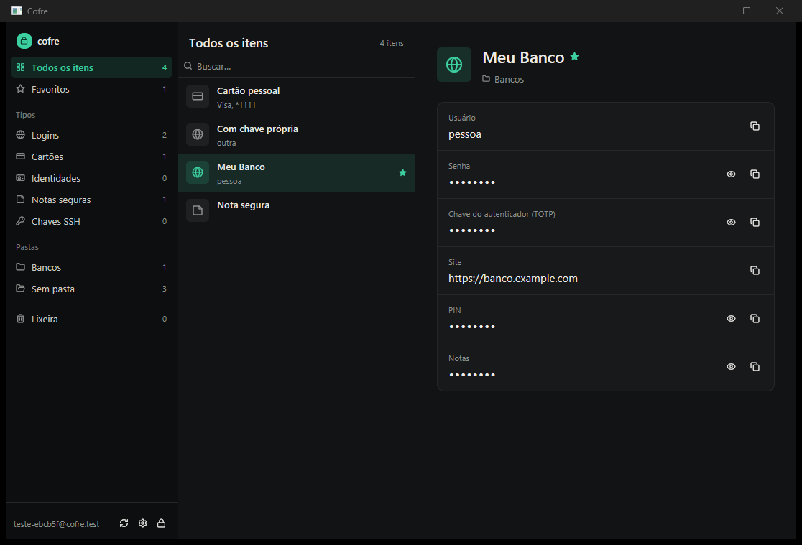
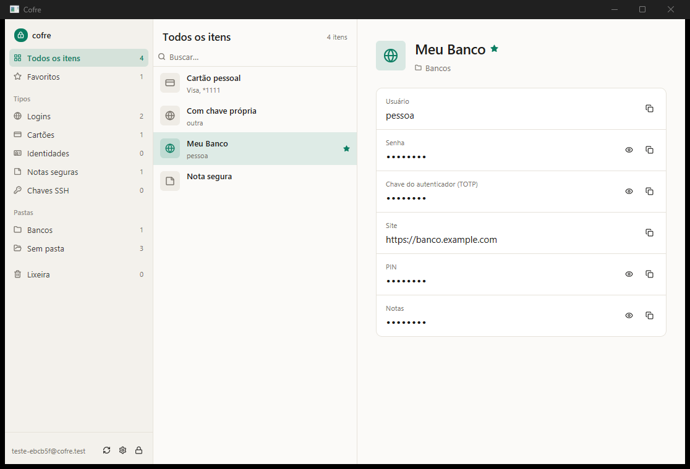

<p align="center"></p>

# Cofre

Cliente desktop nativo, em **Rust + GPUI**, para servidores compatíveis com Bitwarden
(Bitwarden oficial e Vaultwarden). A ideia é ter um app leve e rápido para o dia a dia:
abrir, buscar, copiar e fechar, sem o peso de um app Electron.

> Projeto não oficial, sem afiliação com a Bitwarden Inc. **Em desenvolvimento — não use com seu cofre real ainda.**



---

## Sumário
- [O que já funciona](#o-que-já-funciona)
- [Aparência e configurações](#aparência-e-configurações)
- [Atalhos](#atalhos)
- [Segurança](#segurança)
- [Arquitetura](#arquitetura)
- [Pré-requisitos (Windows)](#pré-requisitos-windows)
- [Rodando](#rodando)
- [Servidor de desenvolvimento](#servidor-de-desenvolvimento)
- [Testes](#testes)
- [Como acrescentar uma configuração](#como-acrescentar-uma-configuração)
- [Roadmap](#roadmap)

---

## O que já funciona

**Entrar**
- Servidores bitwarden.com, bitwarden.eu ou um servidor próprio (Vaultwarden).
- Senha mestra com KDF PBKDF2-SHA256 ou Argon2id. A senha nunca sai da máquina: só vai um hash derivado dela.
- Verificação em duas etapas: autenticador, código por e-mail, YubiKey, chave de segurança
  FIDO2/Windows Hello (API nativa do Windows) e Duo. "Lembrar este dispositivo" guarda o token no
  Gerenciador de Credenciais do Windows.
- Login por **SSO da empresa** (navegador + senha mestra, como o CLI oficial).
- Contas com a **criptografia v2** do Bitwarden (COSE: XChaCha20-Poly1305, XAES-256-GCM).
- Código de verificação de novo dispositivo.
- O servidor, o último e-mail e a identidade do dispositivo ficam salvos para a próxima vez.

**Usar o cofre**
- Lista virtualizada com busca por nome, usuário e endereço, navegável pelo teclado.
- Filtros na barra lateral, cada um com contagem: todos os itens, favoritos, por tipo (logins, cartões,
  identidades, notas, chaves SSH), por organização, por pasta, sem pasta e lixeira.
- O detalhe do item mostra todos os campos, inclusive os customizados e as notas. Os segredos começam
  mascarados e podem ser revelados um a um.
- **Código do autenticador (TOTP) ao vivo**, com os segundos restantes. Aceita chave base32,
  URI `otpauth://` (SHA-1/256/512, dígitos e período próprios) e `steam://` (Steam Guard).
- Ao copiar um segredo, a área de transferência é limpa sozinha em 30 s. Ela só é limpa se você
  não tiver copiado outra coisa depois. No Windows, o que o Cofre copia **não entra no histórico
  (Win+V) nem na área de transferência na nuvem**.
- **Gerador de senhas** (`Ctrl+G` ou o ícone de dados): tamanho, conjuntos de caracteres e opção
  de evitar caracteres parecidos. As opções ficam salvas; a senha gerada, não.
- **Preencher em outros apps** (`Ctrl+Alt+A`, em qualquer janela): o Cofre escolhe o login pelo
  título da janela (nome do item ou site) e **digita** `usuário ⇥ senha ↵` nela, sem passar pela
  área de transferência. Se o título não decidir, mostra a lista para escolher; com o cofre
  bloqueado, pede a senha e digita depois. Liga/desliga (e o Enter final) nas configurações.
- Sincronizar baixa o cofre de novo sem fechar o item que está aberto. Se a sessão tiver expirado
  no servidor, o app volta para o login avisando.

**Editar** (cifrado na sua máquina antes de sair dela)
- **Novo item** (`+` na lista ou `Ctrl+N`): login, nota, cartão ou identidade. **Editar**
  (`Ctrl+E`) qualquer item, inclusive chaves SSH: nome, campos, sites, campos personalizados,
  notas, pasta e favorito. Botão para gerar a senha ali mesmo.
- Ao trocar a senha, a antiga vai para o **histórico de senhas** do item (como nos apps oficiais).
- O Cofre só troca o que você editou: passkeys, regras de URI, campos vinculados e outros dados
  criados por outros clientes voltam intactos ao servidor.
- **Lixeira**: mover, restaurar e **apagar de vez** (pede confirmação).
- **Anexos**: anexar arquivos (até 500 MB), abrir com o programa padrão e salvar onde quiser.
  Cada anexo tem chave própria. A cópia aberta fica em `%TEMP%\Cofre-anexos` e é apagada ao
  bloquear.
- Itens de organização em que você só tem leitura não mostram Editar.

**Preencher no navegador** (Chrome, Edge, Brave)
- Extensão própria na pasta [`extension/`](extension/). Ligue em Configurações → Navegador e
  siga as instruções que aparecem (carregar a extensão sem compactação).
- Num site, clique no ícone do Cofre ou use `Ctrl+Shift+L`: aparecem os logins daquele site
  (domínio base, como no Bitwarden). Clique num para preencher usuário e senha.
- A senha só sai do app quando você clica, e só para um item com endereço do mesmo site.
  A extensão fala com o app por *native messaging* e um canal local que só o seu usuário do
  Windows acessa. Com o cofre bloqueado, o app aparece pedindo a senha.

**Sessão e bloqueio**
- **Lembrar sessão** (ligado por padrão): ao abrir o app, ele vai direto para o desbloqueio, só
  com a senha mestra, e **abre mesmo sem internet**. Guarda o cofre **cifrado** como veio do
  servidor em `%APPDATA%\Cofre\sessao.json` e o refresh token no Gerenciador de Credenciais do
  Windows. "Sair da conta" ou desligar a opção apagam os dois.
- Bloqueia pelo botão de cadeado, por `Ctrl+L` ou sozinho, depois de 5 min sem teclado nem mouse.
- Ao bloquear, o cofre decifrado sai da memória. Para desbloquear basta a senha mestra, sem rede.

## Aparência e configurações

O Cofre tem um visual próprio e minimalista. Os fundos são neutros quentes (um tom de papel no
claro, grafite profundo no escuro), e há **uma única cor de destaque**, usada só onde importa:
seleção, foco, botão principal, favoritos e a marca. Os ícones são do [Lucide](https://lucide.dev)
e aparecem dentro de quadradinhos suaves.

| Claro | Escuro |
|---|---|
|  |  |

As telas de **login e desbloqueio** têm uma arte vetorial animada ao fundo: faixas onduladas nas
laterais que balançam devagar e pequenas formas fechadas (bolinhas, círculos, triângulos,
quadrados, losangos, pentágonos e hexágonos) subindo e girando devagar pelo meio, tudo em traço
fino na cor de destaque. A marca grande fica centralizada sobre o formulário. É desenhada pelo próprio app a cada quadro, sem imagens, e pode
ficar parada em Configurações → Movimento.


A **logo** é um cadeado usando um chapéu de explorador. Ela é o ícone do executável (barra de
tarefas, Alt+Tab, Explorer) e aparece como glifo dentro do app, na cor de destaque escolhida. Tudo
sai de uma geometria só, em `tools/gen_logo.py`:
`python tools/gen_logo.py crates/cofre-app/assets/brand` gera de novo o SVG, os PNGs e o `.ico`.

A tela de **Configurações** abre com `Ctrl+,` ou pela engrenagem. A engrenagem fica na barra
lateral do cofre e também nas telas de login e desbloqueio.


| Opção | Valores | Observação |
|---|---|---|
| Tema | Sistema · Claro · Escuro | "Sistema" acompanha o claro/escuro do Windows na hora |
| Cor de destaque | Jade · Índigo · Latão · Coral · Ameixa · Grafite | Tons escolhidos para o texto do botão principal ter contraste AA |
| Tamanho do texto | Pequeno (14) · Padrão (15) · Grande (17) | Vale para todas as telas |
| Cantos | Retos · Suaves · Redondos | Arredondamento de botões, campos e cartões |

As mudanças valem na hora, sem reiniciar o app. Elas ficam salvas em `settings.json` (veja
[Segurança](#segurança)). Abrir as configurações não fecha o cofre: ele continua por baixo, e
o bloqueio automático segue valendo.


## Atalhos

| Atalho | Onde | Ação |
|---|---|---|
| `Ctrl+,` | qualquer tela | Abre/fecha as configurações |
| `Ctrl+Alt+A` | **qualquer app do Windows** | Preenche usuário e senha na janela em foco |
| `Ctrl+G` | qualquer tela | Abre/fecha o gerador de senhas |
| `Esc` | configurações, gerador, lista de preenchimento | Fecha |
| `Ctrl+F` | cofre | Vai para a busca |
| `Ctrl+N` | cofre | Novo item |
| `Ctrl+E` | cofre | Edita o item aberto |
| `Ctrl+U` | cofre | Copia o usuário do item aberto |
| `Ctrl+P` | cofre | Copia a senha do item aberto |
| `Ctrl+T` | cofre | Copia o código do autenticador do item aberto |
| `Ctrl+L` | cofre | Bloqueia |
| `↑` `↓` | lista | Move a seleção |
| `Enter` | lista | Abre o item |

A cópia usa `Ctrl+U`/`Ctrl+P`/`Ctrl+T` (como o app oficial) em vez de `Ctrl+C`, que continua
copiando o texto selecionado na busca.

## Segurança

- **Nada decifrado vai para o disco.** Os segredos vivem em memória dentro de `Secret`/`Zeroizing`
  e são apagados quando liberados. O `Debug` deles nunca mostra o conteúdo.
- O `settings.json` (`%APPDATA%\Cofre\settings.json` no Windows e `~/.config/cofre/settings.json` nos
  demais) guarda **só** o servidor, o último e-mail, a identidade do dispositivo e a aparência.
- A criptografia segue o esquema do Bitwarden. O HMAC é conferido em tempo constante **antes** de
  decifrar com AES-256-CBC. As chaves de organização usam RSA-OAEP, e cada item pode ter chave própria.
- Um item ou uma organização corrompidos não derrubam o resto do cofre: eles aparecem como erro
  isolado.
- Rede e KDF rodam fora da thread de UI, então a interface nunca trava.
- O desenvolvimento é sempre contra um **Vaultwarden local**, nunca contra um cofre real.

## Arquitetura

```
crates/
  cofre-core/      protocolo, criptografia e modelo do cofre — sem UI, testável sozinho
    api.rs         cliente HTTP: prelogin, login (2FA, novo dispositivo), refresh, sync
    crypto.rs      master key (PBKDF2/Argon2id), HKDF, AES-CBC + HMAC, RSA-OAEP
    enc_string.rs  formato EncString (2.iv|ct|mac, 4.data)
    sync.rs        resposta do sync, ainda cifrada
    vault.rs       cofre decifrado: itens, pastas, organizações, busca
  cofre-app/       interface GPUI (binário `cofre`), via gpui-kit
    app.rs         raiz da janela: troca de telas, bloqueio automático, configurações
    login.rs       login, 2FA, novo dispositivo
    unlock.rs      desbloqueio offline
    vault_view.rs  barra lateral, lista e detalhe
    item_list.rs   dados da lista: filtro e busca
    appearance.rs  paleta, temas claro/escuro, cor de destaque, texto e cantos
    settings_view.rs  tela de configurações
    ui.rs          peças visuais compartilhadas (marca, chips, controle segmentado)
    build.rs       embute o ícone (assets/brand/cofre.ico) no executável do Windows
    assets/brand/  logo colorida (SVG/PNG/ICO) e o glifo monocromático da marca
    settings.rs    preferências não sensíveis em disco
    flow.rs        fluxos de login/sync sem UI
dev/               Vaultwarden local (docker-compose)
tools/             gerador de fixtures, de conta de teste e da logo (Python)
docs/ROADMAP.md    plano por fases
```

**Como o tema funciona:** `appearance.rs` parte dos temas padrão do gpui-kit e troca as cores pela
paleta do Cofre (neutros de cada modo mais a cor de destaque). Depois ajusta tamanho da fonte e
raios e registra o resultado como os temas claro e escuro. `appearance::apply` faz isso e escolhe
o modo. O `CofreApp` chama essa função ao abrir e quando o Windows troca de claro para escuro (se
o tema for "Sistema"). A tela de configurações também chama a cada mudança.

## Pré-requisitos (Windows)
- Rust estável: `winget install Rustlang.Rustup`
- Visual Studio Build Tools com a carga "Desenvolvimento para desktop com C++" (linker MSVC + Windows SDK)
- Docker Desktop ou Docker no WSL (só para o servidor de desenvolvimento)
- Python 3 com `cryptography` (só para as ferramentas de `tools/`)

## Rodando
```bash
cargo run            # abre o app
cargo run --release  # build otimizado, sem console no Windows
```

Em builds de debug, o app pode entrar sozinho no Vaultwarden local com a conta de teste. Isso só
funciona com servidores em `localhost`:
```bash
set -a; . dev/test-account.env; set +a
COFRE_DEV_AUTOLOGIN=1 cargo run
```

## Servidor de desenvolvimento
O Vaultwarden local roda em `http://localhost:8000` e funciona com Docker Desktop ou com o Docker
instalado dentro do WSL (sem Docker Desktop):
```bash
wsl -d Ubuntu -u root -- bash -c "service docker start; cd /mnt/d/Repositories/cofre/dev && docker compose up -d"
```
O WSL desliga quando fica ocioso; mantenha um terminal do WSL aberto enquanto testa.

Para criar uma conta de teste já populada, sem navegador (as credenciais vão para
`dev/test-account.env`, que o git ignora):
```bash
python tools/dev_seed.py
```

## Testes
```bash
cargo test --workspace                 # tudo (núcleo + UI headless)
cargo test -p cofre-core               # só o núcleo
cargo test -p cofre-app --test ui      # só a UI
```

- **Núcleo:** `tools/gen_fixtures.py` gera um cofre sintético completo usando a biblioteca
  `cryptography` do Python, uma implementação independente da nossa. O arquivo
  `tests/fixtures.rs` precisa abrir esse cofre e bater cada valor.
- **UI:** os testes rodam as telas reais numa janela headless, com cliques e digitação de verdade.
  Eles cobrem a validação do login, filtros, busca, revelar e copiar (com a limpeza da área de
  transferência), bloqueio manual e por inatividade, troca de tema, cor, texto e cantos, e a
  aparência restaurada ao reabrir.
- **Ao vivo** (precisa do Vaultwarden local):
  ```bash
  set -a; . dev/test-account.env; set +a
  cargo test -p cofre-core --test live_server -- --ignored --nocapture
  cargo test -p cofre-app --test ui -- --ignored
  ```
- **2FA ao vivo:** `python tools/dev_seed.py --totp` cria uma conta com autenticador
  (credenciais em `dev/test-account-2fa.env`) para `cargo test -p cofre-app --test live_2fa -- --ignored`.

A CI (Windows) roda `cargo fmt --check`, `cargo clippy -D warnings` e `cargo test --workspace`.
Os testes headless não desenham pixels. Por isso, mudanças visuais precisam ser conferidas numa
janela real.

## Como acrescentar uma configuração
1. Acrescente o campo em `Appearance` (`appearance.rs`) com `#[serde(default)]`. Assim um
   `settings.json` antigo continua abrindo.
2. Se o campo mudar o tema, aplique-o em `appearance::build`. Se não mudar, leia-o onde for usado.
3. Acrescente uma linha em `SettingsView::render` (`settings_view.rs`) com `Self::row(...)`. O
   controle pode ser um `ui::segmented`, um `Switch` ou algo próprio. Para uma nova seção, use
   outro `Self::group(...)`.
4. Escreva um teste em `tests/ui.rs` que clique no controle e confira o efeito.

## Roadmap
Veja [docs/ROADMAP.md](docs/ROADMAP.md). Os próximos passos são o cache cifrado para abrir offline,
bloquear junto com o Windows, a busca rápida por atalho global e, depois, edição de itens.
